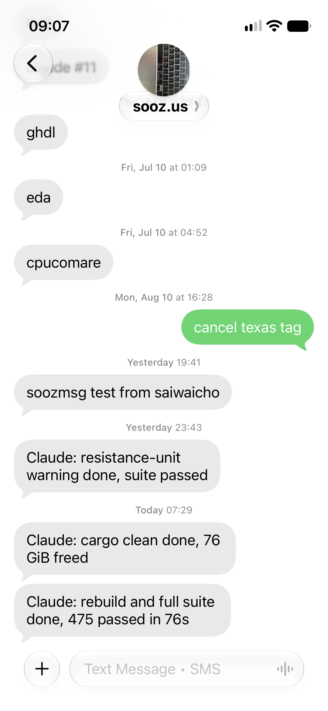

# sooz clients

text yourself!   I use these to send myself SMS messages for better control of notifications.  
This was designed for me to add to my todo lists from my flip phone, but it's easier to see
on a smart phone:

  

I've been having claude send me messages when done.

Small scripts that text your phone via [sooz.us](https://sooz.us) when
something finishes or changes. Each needs a sooz **notify token** set to
`every hit` mode.

| Directory | What it does | Needs |
|---|---|---|
| [`shell/`](shell/README.md) | `soozmsg.sh`: send a text, enroll a device, or wrap a command and text when it exits | POSIX sh, curl |
| [`claude-code/`](claude-code/README.md) | `sooz-notify.sh`: Claude Code hook that texts when a long turn finishes | bash, python3, `soozmsg` |
| [`powershell/`](powershell/README.md) | `soozwatch.ps1`: watch a screen region and text when it changes; `soozmsg.cmd`: Windows `soozmsg` (enroll, text, run) | Windows PowerShell 5.1+ |

## Token

Scripts look for the token in this order:

1. `SOOZ_NOTIFY_TOKEN` environment variable
2. `~/.config/soozmsg/config`, line `notify_token = ...`

```sh
soozmsg "test"    # should buzz your phone
```

## License

MIT. See [LICENSE](LICENSE).
